# 5-Leg Multi-Tier Arbitrage System & High-Performance Logging Architecture

## 1. Executive Summary & Requirements Breakdown

This architectural specification documents the transformation of the Crypto Arbitrage Terminal from a single-pair position engine to a high-throughput **5-Leg Multi-Tier Scalping Engine** equipped with **SQLite trade persistence**, an **Execution JSON telemetry payload**, **day-by-day granular rotating logs**, and a **sidebar-driven dashboard**.

---

### Core Enhancements

| # | Feature | Details | Performance Guarantee |
|---|---|---|---|
| **1** | **5-Leg Independent Matrix** | Leg 1 to Leg 5 with customizable Open Gap (`diffToTrade`), Close Cut Gap (`diffToCut`), Lot Size, and Net TP Target ($). | Each leg evaluates independently; opens and cuts at exact target points. |
| **2** | **SQLite Trade History + Telemetry JSON** | Complete relational database (`data/trades.db`) storing every entry, exit, PnL, tickets, and rich `execution_json` field. | **Asynchronous / Post-Execution**: zero blocking I/O on the order placement path. |
| **3** | **Day-by-Day Rotating Logs** | Daily log files (`logs/trade_YYYY-MM-DD.log`) recording single-se-single error, tick updates, order states, and hedge reconciliations. | Uses rotating file handler + log buffer with microsecond timestamps. |
| **4** | **Sidebar Multi-View UI** | Navigation sidebar between **Live Terminal (5 Legs)**, **Trade History (with JSON Inspector)**, and **Daily Log Viewer**. | Sleek glassmorphism dark mode with real-time WebSocket updates. |

---

## 2. 5-Leg Multi-Tier Engine Architecture

### 2.1 The Concept of 5 Legs
Previously, the system was constrained to `len(active_positions) == 0`, meaning only 1 position pair could exist at any moment. 

In volatile arbitrage markets, the basis spread widens progressively (e.g. from $4.00 to $6.00, $8.00, $10.00, $12.00). A 5-Leg engine allows capturing the spread at multiple tier depths:

```
Market Spread ($)
     ▲
$12  ├────────────────────────── [ Leg 5 Opens: 0.20 lots | Cut: $2.50 ]
     │
$10  ├────────────────────────── [ Leg 4 Opens: 0.15 lots | Cut: $2.00 ]
     │
$8   ├────────────────────────── [ Leg 3 Opens: 0.10 lots | Cut: $1.50 ]
     │
$6   ├────────────────────────── [ Leg 2 Opens: 0.10 lots | Cut: $1.00 ]
     │
$4   ├────────────────────────── [ Leg 1 Opens: 0.10 lots | Cut: $0.50 ]
     │
$0   └────────────────────────── Normal Market Baseline
```

### 2.2 Independent Leg Lifecycle
Each leg operates as an independent state machine:
- **`IDLE`**: Waiting for live gap `abs(spread) >= leg.diff_to_trade`.
- **`OPENING`**: Order sent concurrently to MT5 and Futures exchange (Bybit/Binance/Deribit/Delta).
- **`OPEN`**: Position active, tracking floating Net PnL after all fees, spread, and slippage.
- **`CUT_TRIGGERED`**: Live gap compresses to `abs(spread) <= leg.diff_to_cut` OR `net_pnl >= leg.target_profit_usd`.
- **`CLOSING`**: Closing orders placed on MT5 and Futures exchange.
- **`CLOSED`**: Post-execution trade record persisted to SQLite DB with execution JSON snapshot. Status returns to `IDLE` ready for next cycle.

---

## 3. Asynchronous Zero-Latency Execution Pipeline

To satisfy the critical constraint:
> *"execute fast hona chahiye logging history vaigera trade execute ke bad main karo"*

The order execution path is completely decoupled from disk I/O, database writes, and serialization:

```mermaid
sequenceDiagram
    autonumber
    participant MD as Market Data Loop
    participant ENG as 5-Leg Arbitrage Engine
    participant BROKER as MT5 & Futures API
    participant BG as Background Async Worker
    participant DB as SQLite (trades.db)
    participant LOG as Daily Log File (trade_YYYY-MM-DD.log)

    MD->>ENG: evaluate(mt5_tick, futures_tick)
    Note over ENG: Check Leg 1..5 triggers
    ENG->>BROKER: ⚡ Send Market Orders (MT5 + Futures Hedge)
    BROKER-->>ENG: Order Confirmation (Tickets / IDs)
    ENG-->>MD: Return Live Evaluation State (Fast!)
    
    rect rgb(20, 35, 55)
    Note over BG,LOG: 🕒 POST-EXECUTION (Async / Non-Blocking)
    ENG-)BG: enqueue_trade_record(trade_data, raw_telemetry)
    BG->>DB: INSERT / UPDATE into SQLite DB
    BG->>LOG: Write detailed Execution JSON & Logs
    end
```



---

## 4. SQLite Database Schema (`data/trades.db`)

```sql
CREATE TABLE IF NOT EXISTS trade_history (
    id INTEGER PRIMARY KEY AUTOINCREMENT,
    trade_id TEXT UNIQUE NOT NULL,
    leg_id INTEGER NOT NULL,               -- Leg 1 to 5
    symbol_spot TEXT NOT NULL,             -- e.g. ETHUSD / BTCUSD
    symbol_fut TEXT NOT NULL,              -- e.g. ETHUSDT_261225
    exchange TEXT NOT NULL,                -- BINANCE / BYBIT / DERIBIT / DELTA
    action_type TEXT NOT NULL,             -- BUY_SPOT_SELL_FUT / SELL_SPOT_BUY_FUT
    trade_size REAL NOT NULL,              -- Volume / Lot size
    entry_spot_price REAL NOT NULL,
    entry_fut_price REAL NOT NULL,
    entry_gap REAL NOT NULL,
    exit_spot_price REAL,
    exit_fut_price REAL,
    exit_gap REAL,
    open_time TEXT NOT NULL,               -- ISO 8601 string
    close_time TEXT,
    duration_sec REAL,
    pnl_gross REAL DEFAULT 0.0,
    pnl_net REAL DEFAULT 0.0,
    fee_estimated REAL DEFAULT 0.0,
    status TEXT NOT NULL,                  -- OPEN / CLOSED / CIRCUIT_BREAKER
    exit_reason TEXT,                      -- DIFF_TO_CUT / TAKE_PROFIT / MANUAL / CIRCUIT_BREAKER
    mt5_ticket INTEGER,
    fut_order_id TEXT,
    execution_json TEXT                    -- Rich Telemetry JSON payload
);

CREATE INDEX IF NOT EXISTS idx_trades_leg ON trade_history(leg_id);
CREATE INDEX IF NOT EXISTS idx_trades_status ON trade_history(status);
CREATE INDEX IF NOT EXISTS idx_trades_open_time ON trade_history(open_time);
```

### 4.1 `execution_json` Telemetry Payload Structure
```json
{
  "trade_id": "PAIR-LEG1-1001",
  "leg_id": 1,
  "timestamps": {
    "tick_received_ms": 1728118000120,
    "trigger_evaluated_ms": 1728118000121,
    "mt5_order_sent_ms": 1728118000122,
    "mt5_order_received_ms": 1728118000165,
    "fut_order_sent_ms": 1728118000166,
    "fut_order_received_ms": 1728118000210,
    "total_execution_latency_ms": 90.0
  },
  "entry_snapshot": {
    "spot_bid": 2450.10,
    "spot_ask": 2450.40,
    "spot_mid": 2450.25,
    "fut_bid": 2455.50,
    "fut_ask": 2455.80,
    "fut_mid": 2455.65,
    "spread_usd": 5.40,
    "slippage_spot": 0.05,
    "slippage_fut": 0.10
  },
  "broker_responses": {
    "mt5": { "ticket": 98451203, "retcode": 10009, "comment": "Auto Leg1 Gap $5.40" },
    "futures": { "orderId": "8741295712", "status": "FILLED", "avgPrice": "2455.50" }
  },
  "exit_snapshot": {
    "close_time": "2026-10-05T12:05:30.150Z",
    "exit_spot_mid": 2452.00,
    "exit_fut_mid": 2452.50,
    "exit_gap": 0.50,
    "captured_gap": 4.90,
    "exit_reason": "DIFF_TO_CUT_REACHED"
  }
}
```

---

## 5. Day-by-Day Rotating Log Design

1. **Daily Log Files**: Located in `logs/trade_YYYY-MM-DD.log`.
2. **Granular Level Logging**:
   - `[DEBUG]`: Ticks and spread calculations.
   - `[INFO]`: Leg trigger, order submission, confirmations, take-profit compressions.
   - `[WARN]`: Price staleness, spread widening against open leg, partial fills.
   - `[ERROR]`: Single-se-single error logged with stack trace (MT5 failure, broker rejects, connection timeouts, circuit breakers).
3. **Format**:
   `[2026-10-05 11:45:02.128] [INFO] [arbitrage_engine:evaluate:142] [LEG-1] OPEN trigger fired | MT5 Ticket #81923 | Bybit Order #99120`

---

## 6. Frontend Navigation & UI Architecture

### 6.1 Sleek Navigation Sidebar
- **⚡ Live Terminal (Dashboard)**:
  - 5-Leg Multi-Tier Control Panel (Cards for Leg 1..5 with inputs, live toggles, and status badges).
  - Live Gap & Prices Bar, TradingView Candlestick Chart, MT5 & Futures live quotes.
  - Active positions table.
- **📊 Trade History (SQLite Database View)**:
  - Dynamic table with pagination, leg filter (All / Leg 1..5), status filter (Open / Closed).
  - Aggregate metrics: Total Realized Net PnL, Win Rate %, Total Volume.
  - Interactive "View JSON" modal with formatted code syntax and 1-click copy.
- **📜 Daily System Logs**:
  - Live log viewer dropdown by date (`trade_2026-10-05.log`, etc.).
  - Search filter (search for specific ticket, error code, or "ERROR").
  - Auto-refresh toggle.

---

## 7. Implementation Plan

1. **Step 1**: Implement `database.py` with SQLite schema, async worker, and rich JSON storage.
2. **Step 2**: Implement `logger_setup.py` with daily rotation and granular logging.
3. **Step 3**: Refactor `arbitrage_engine.py` to support the 5-Leg Matrix, independent cut/TP triggers, and async trade dispatch.
4. **Step 4**: Update `server.py` with new REST routes (`/api/legs`, `/api/history`, `/api/logs`, `/api/fire-leg`, `/api/close-leg`).
5. **Step 5**: Upgrade UI (`static/index.html`, `static/style.css`, `static/app.js`) with sidebar navigation, 5-leg matrix cards, history explorer with JSON inspector modal, and day-by-day log browser.
6. **Step 6**: Test and verify the complete end-to-end multi-leg execution and logging pipeline.
